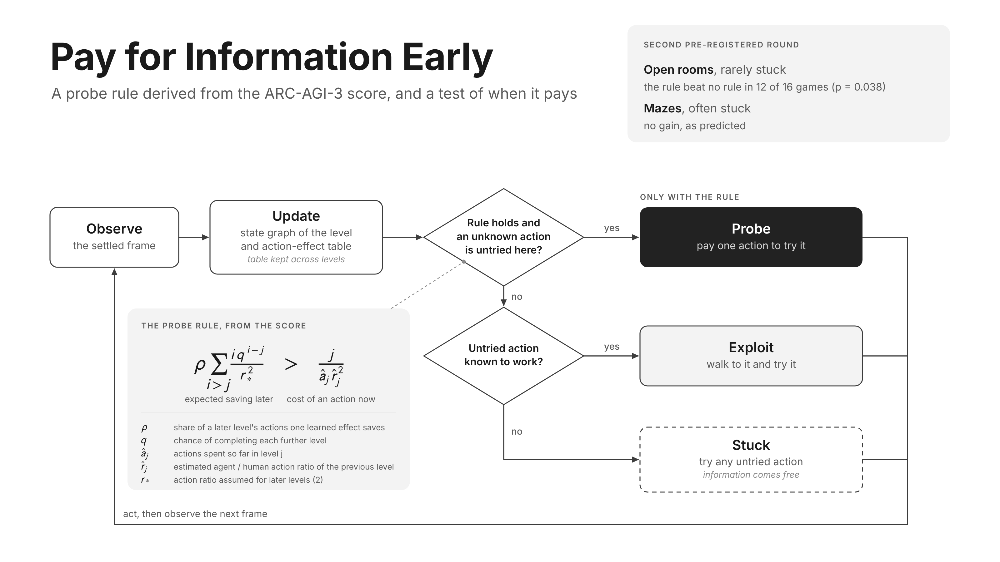
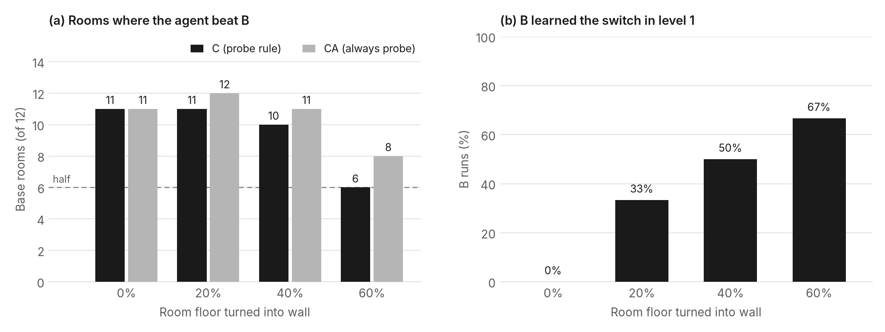
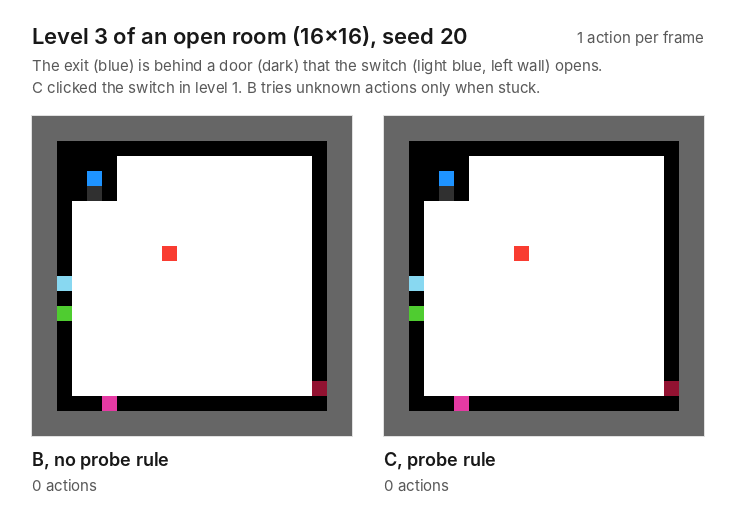

# Pay for Information Early

A probe rule derived from the ARC-AGI-3 score, and a test of when it pays.

This repository holds the agent, the synthetic game suites, the results of every run reported in the paper, the figures and the pre-registration record of an ARC Prize 2026 Paper Track entry. All of it is released under CC0 1.0 (public domain dedication).

- Paper: Kaggle Writeup, ARC Prize 2026 Paper Track (link added after submission)
- Code submission: ARC-AGI-3 Kaggle notebook (link added after submission)
- Technical appendix (A to H, cited by the paper): [docs/appendix.md](docs/appendix.md)



## The idea

ARC-AGI-3 scores each completed level by the square of human over agent actions, capped at 1.15, and weights level i by i. Saving one action in level i is therefore worth i h_i^2 / a_i^3, and saving a share of the level is worth i / r_i^2, with r_i = a_i / h_i the agent's action ratio. Later levels of the 25 public games take more human actions (a median 3.9 times the first), so at equal efficiency one last-level action is worth only a median 1.5 times a first-level one, while a share of a level is worth i times as much (Figure 2). Information saves a share of later levels. A probe (one action spent to learn what an untried action does) is therefore worth buying in level j only if:

```
rho * sum_{i>j} i * q^(i-j) / r_*^2  >  j / (a_hat_j * r_hat_j^2)
```

`rho` is the fraction of a later level's actions that one settled effect saves, `q` the chance of completing each further level, `r_*` the target action ratio (2.0), `a_hat_j` the actions already spent in level j and `r_hat_j` the action ratio of the previous level. The saving is counterfactual: it is zero if the agent would try the same action anyway, for instance while stuck. The two synthetic suites vary exactly that.

## Results

### Synthetic suites

Second pre-registered round, its registered replication on 16 new room games (seeds 30 to 34), and the registered cluttered-room suite: 48 games, 12 base rooms of 16x16 at 0, 20, 40 and 60% clutter (seeds 40 to 44). The other suites have 16 evaluation games; every game runs five seeds. Game counts exclude ties, except H5.

| Test (criterion) | Open rooms | New rooms (replication) | Mazes | Cluttered rooms |
| --- | --- | --- | --- | --- |
| H1 transfer: median B/A actions, levels 3+ (≤ 0.85) | 0.45, pass | 0.43, pass | 0.59, pass | 0.51, pass |
| H2 placement: C beats C' (≥ 60% of games, p < 0.05) | 13 of 16, p = 0.011, pass | 9 of 16, p = 0.40, fail | 7 of 14, p = 0.60, fail (predicted) | 30 of 48, p = 0.056, fail (no prediction) |
| H4 depth: gain falls with difficulty (Spearman < 0, p < 0.05) | +0.56, fail | +0.19, fail (predicted) | -0.29, p = 0.14, fail (predicted) | -0.41, p = 0.002, pass (difficulty = clutter) |
| H5 discount: C beats C1 in the harder half (≥ 60%) | 6 of 8, met | 3 of 8, not met | 3 of 8, not met | 4 of 24, not met (12 tied: q = 1 at 60%) |
| H6 value: C beats B (≥ 60% of games, p < 0.05) | 12 of 16, p = 0.038, pass | 13 of 16, p = 0.011, pass | 6 of 14, p = 0.79, fail (predicted) | 38 of 48, p < 0.001, pass |
| K1 dose: C's gain over B falls with clutter within base rooms (p < 0.05) | | | | -0.40, p = 0.009, pass |
| K2 free learning: B learns the switch in level 1 more often with clutter (p < 0.05) | | | | +0.78, p < 0.001, pass |
| C beats C'r, the same budget over the levels C reached | 10 of 16, p = 0.23 (exploratory) | 9 of 16, p = 0.40 | 7 of 14, p = 0.60 (exploratory) | 30 of 48, p = 0.056 (exploratory) |
| C beats CA, always probing (exploratory) | 9 of 14 | 5 of 14 | 8 of 14 | 18 of 48 |
| Mean RHAE (%), B / C / C' / CA | 0.114 / 0.580 / 0.288 / 0.584 | 0.175 / 0.745 / 0.563 / 0.929 | 1.113 / 1.040 / 1.173 / 1.056 | 0.684 / 1.179 / 0.993 / 1.556 |
| Levels completed per run, B / C / C' | 2.49 / 3.60 / 3.23 | 2.58 / 3.61 / 3.52 | 3.09 / 2.80 / 3.20 | 3.73 / 5.91 / 5.04 |



- Predictions were recorded before the runs. Round 2: everything passes in rooms; H2, H4 and H6 fail in mazes. Eight of the ten held: H4 failed in rooms, because early information also made later levels reachable, and H5 was not met in mazes. Replication (docs/registration_replication.md, committed before its games were generated): H1, H2 and H6 pass, H4 fails, no prediction for H5, C does not meet the criterion against C'r, and CQ's mean is at least C's. Five of the six held; H2 did not replicate. Cluttered rooms (docs/registration_clutter.md, committed before its evaluation games were generated): K1, K2, H1, H4 and H6 pass and K3 is negative; all six held. H3 (choosing probe targets by information gain) was not run.
- Why: B tries actions of unknown effect only when stuck. In mazes it is stuck often enough to learn the switch in level 1 (76 of 80 runs), in open rooms never (0 of 80; scripts/diagnose_free_learning.py on step logs). Clutter turns one into the other: B learned the switch in level 1 in 0, 33, 50 and 67% of runs as clutter rose, and C beat B in 11, 11, 10 and 6 of 12 base rooms. B itself scored higher with more clutter, so it is C's relative gain, the registered measure, that fell; the absolute gain did not.
- What held up in the synthetic suites: probing before being stuck, not the rule's timing. Pooled over the 32 room games, C beat B in 25 (p = 0.001), but so did C' (25), C'r (27) and always probing, CA (28); C was above CA in 14 and below in 14. In cluttered rooms CA was above C in 30 of 48 games. On real games its restraint seemed to protect the levels the explorer clears fast (exploratory, below), and with a short synthetic first level it did (registered, next item).
- Short first levels (docs/registration_short.md, committed before its evaluation games were generated): 12 base rooms of 16x16, each with an open first level (d1) and with level 1 shrunk to a pocket around the exit (d2; levels 2 to 6 identical), seeds 60 to 64. All five predictions held. In d2, B and C cleared level 1 in a median 4 actions (human 2); CA spent a median 29 probes there and C none, and C beat CA in 11 of 12 games (p = 0.003) and B in 12 of 12. With the open first level C and CA tied (6 and 6), and C's margin over CA was larger in d2 in 11 of 12 base rooms. Mean RHAE (%), d1 / d2: B 0.198 / 2.106, C 0.854 / 2.765, CA 0.815 / 0.548. Level 1 gave 86% of C's margin over CA in d2 (on level 1 alone C was ahead in 12 of 12). CA also lost later levels, because probing the pocket's walls made it class moves as no-ops (45 of 60 runs; Known issues), but in the 15 runs without that error C still scored higher in 12.
- Two trivial controls, R (repeat an action until the frame stops changing) and K (click every object once), completed no level in any synthetic game (320 runs). On the 10 held-out public games they completed 8 levels in 100 runs, all by K in one click game (vc33), while B and C completed 31 and 36 levels in 50 runs each.
- C' could not spend its whole allotment, because the quota of a level it never reached lapsed and, in mazes, little was left unknown: it used 61% in rooms, 31% in mazes and 30% on real games. C'r, which splits the same allotment over the levels C reached, used 86% in rooms (Appendix E).
- The reach discount q did not help: C1 (q = 1) had a higher mean RHAE than C in every suite and on real games, and in rooms so did CQ, C with q re-estimated from its own completion rate (Appendix E).
- Two thirds of C's room gain over B came in levels 1 and 2 (47% in the replication), and with rho at the top of its grid the rule held within six actions in most room levels, so the rooms test early probing more than the rule's exact threshold (Appendix H, figs/figureA1_where_gains_come_from.png).
- Exploratory follow-ups: in rooms, most of C's gain came from learning its four moves early rather than from the designed switch (step-log replays). An ablation that gives every agent its moves and removes the door before level 3 isolates the switch: C beat B on levels 3 to 6 in 12 of 14 untied games, but level-1 probe costs offset this in total RHAE (C above B in 9 of 16).

The first round (mazes only) failed H2 and H4 because of two bugs: the click-priority threshold rose to its maximum at the first action of every game, and floor and wall pieces got a new type key at every state, so most probes went to floor tiles. Its agent is kept in `archive/round1/` and its results in `runs/syn_r1_*`.

### Real games

Registered test on the 25 public ARC-AGI-3 games (`docs/registration_real.md`, committed before its runs): B, C (rho = 3e-4, q = 0.5) and CA, 20 new seeds (15 to 34) per game, compared game by game with one-sided sign tests, ties dropped. Four of the six predictions held.

| Test (criterion) | Predicted | Result |
| --- | --- | --- |
| R1 levels: CA completes more than B (≥ 60% of untied games, p < 0.05; primary) | pass | 6 of 8, p = 0.14, fail |
| R2 levels: C completes more than B (same; primary) | pass | 7 of 9, p = 0.090, fail |
| R3 RHAE: CA above B (same) | fail | 6 of 17, p = 0.93, fail |
| R4 RHAE: C above B (same) | fail | 9 of 16, p = 0.40, fail |
| R5 levels, game-seed pairs: CA above B more often than below (p < 0.05) | pass | 48 vs 27, p = 0.010, pass |
| R6 levels, game-seed pairs: C above B more often than below (p < 0.05) | pass | 36 vs 15, p = 0.002, pass |
| Mean RHAE (%), B / C / CA | | 0.400 / 0.393 / 0.225 |
| Levels completed per run, B / C / CA | | 0.850 / 0.896 / 0.898 |

- Kaggle (ARC-AGI-3 public leaderboard): the submitted agent, C with rho = 3e-4 and q = 0.5, scores 0.37 (RHAE in percent; notebook version 2). The same agent with always probing, CA, as its default scores 0.26 (version 3, exploratory).
- Probing raised the levels completed in more runs than it lowered them, but most games tied (no configuration cleared level 1, or all cleared the same levels), so the game-level tests R1 and R2 failed. Game-seed pairs of one game are not independent, as the registration notes: CA's margin came mostly from bp35 (16 to 0; 32 to 27 without it), while C's was spread over games. C's mean RHAE matched B's; CA's was 44% lower.
- Where always probing lost (exploratory; `scripts/analyze_where_probing_lost.py`): 17% of the real levels B completed (72 of 425) took at most three times the human actions, against 0 to 3% in the synthetic suites, and they earned 88% of B's real-game score. One action in level j costs in proportion to j / (a_j r_j^2), so probes are dearest there. In the same game, seed and level, CA's RHAE fell by 7.64 points summed over games and C's by 0.77: in the 45 such level 1s C made no probe and matched B exactly, while CA averaged 55.7 probes. In r11l, B and C cleared level 1 in a median 59 actions (human 22), CA in 988. Over the 17 games in which B cleared level 1, CA's change in RHAE rose with B's level-1 action ratio (Spearman +0.51, p = 0.019; C +0.02). This is a real-game observation: in the cluttered rooms, where 3% of B's completed levels were that fast and earned 50% of its score, most of them came after level 1, little was left to probe, and C and CA lost there by similar amounts.
- Earlier runs (exploratory, seeds 10 to 14): on the 10 held-out public games, calibrated on the other 15 (rho = 3e-4, q = 0.5), C was no better than B, C' or CA (mean RHAE 0.082% for B, 0.079% for C, 0.110% for C', 0.115% for CA). The agent completes under one level per game there, so H1 could not be tested. Rerun at seeds 10 to 14 with step logs (identical rows), B learned in level 1 79% of the action types C found useful there (70% on the design games); the rest could pay mainly in later levels, which C reached in 60% of the held-out runs.

## Layout

```
agent/my_agent.py        the agent: configurations A, B, C, C1, CU (C'), CR (C'r), CA and the controls R, K
scripts/                 run, generate, verify, calibrate and analyze
synthetic/               the generated suites, in the local ARC-AGI-3 game format
  mazes_round1/          six-level mazes n = 6, 8, 10, 12; evaluation 00-03, calibration 05-07
  mazes_round2/          same generator; evaluation 10-13, calibration 05-07
  rooms/                 six-level open rooms n = 12, 16, 20, 28; evaluation 00-03, calibration 05-07
  rooms_ablation/        rooms evaluation games without a door before level 3
  rooms_rep/             new room evaluation games 10-13 for the registered replication
  clutter/               16x16 rooms with 0, 20, 40 or 60% of the floor turned into wall; evaluation 30-41, calibration 05-07
  short/                 16x16 rooms with an open first level or a pocket around the exit; evaluation 50-61, calibration 05-10
runs/                    one results.jsonl per run (plus console.log where kept)
figs/                    figures 1 to 3, the level-3 replay GIF and the scripts that draw them
docs/appendix.md         technical appendix A to H (protocol, agent, rule, hyperparameters, suites, history)
docs/registration_ko.md  the pre-registration record (Korean, as written before the runs)
docs/registration_replication.md  the replication's registration, committed before its games existed
docs/registration_clutter.md      the cluttered-room suite's registration, committed before its evaluation games existed
docs/registration_real.md         the real-game test's registration, committed before its runs
docs/registration_short.md        the short-level rooms' registration, committed before their evaluation games existed
archive/round1/          the round-1 agent and its q values
splits.json              frozen design / held-out split of the 25 public games
```

## Configurations

Set with `ARC_AGENT_CONFIG` (run_experiments.py does this).

| Config | Behaviour |
| --- | --- |
| A | action-effect table rebuilt from the current level only |
| B | table kept across levels; unknown actions are tried only when the agent is stuck |
| C | B plus the probe rule |
| C1 | C with q = 1 (no reach discount) |
| CU (C') | as many probes as C used on the same game and seed, spread evenly over the levels |
| CR (C'r) | as CU, but spread over the levels C reached in that game and seed, so quota of unreached levels is not lost |
| CA | always probe: an untried action of unknown effect comes first whenever there is one, in every level |
| R | trivial control: repeat one action until the frame stops changing twice, then the next |
| K | trivial control: click every object of a state once, then cycle the simple actions |

CQ in the results is C run with q re-estimated from C's own completion rate (`scripts/calibrate.py qc`, `runs/syn_rooms_qC.json`). The Kaggle submission runs C with the agent's defaults, rho = 3e-4 and q = 0.5, the values calibrated on the 15 public design games. The agent acts only through the documented actions and does not rely on engine bugs; human baselines are used only for scoring and are never read by the agent.



Level 3 of an open room (16x16, game r203, seed 20), replayed from the confirmation runs. C, which clicked the switch in level 1, clears the level in 29 actions; B, which tries unknown actions only when stuck, needs 1,094.

## Setup

Python 3.12. The agent plugs into the official ARC-AGI-3 agent template (MIT), which is not included here.

```
python3.12 -m venv .venv
.venv/bin/pip install -r requirements.txt
git clone https://github.com/arcprize/ARC-AGI-3-Agents vendor/ARC-AGI-3-Agents
git -C vendor/ARC-AGI-3-Agents checkout 4743e7d0aaae0ded0d98a89a7e282e63564cd58b
.venv/bin/python scripts/slim_template.py
```

The last command replaces the template's `agents/__init__.py`, which imports LLM-backed example agents whose packages are not installed here, with a minimal one that registers only the template's random agent (the official Kaggle sample notebooks do the same at run time). Without it every run fails with `ModuleNotFoundError`. `scripts/run_experiments.py` records a failed run as an ERROR row and still exits 0, so check its summary. The PNG of figure 1 also needs Playwright, which is not in requirements.txt.

Runs are deterministic: the same game, configuration and seed give the same actions. From a fresh clone set up as above (2026-10-28), 36 sampled evaluation rows (B, C and CA in rooms, mazes and cluttered rooms) and all 480 rows of `runs/syn_clutter_diag` reproduced exactly, apart from the timing field and the unused rho and q fields described below.

## Reproduce

Synthetic suites (already included; regenerating gives the same games, except that `synthetic/rooms` was generated before `make_rooms.py` gained `--door-from`, so its game files lack the `DOOR_FROM` constant, which defaults to 1 and leaves the games unchanged):

```
P=.venv/bin/python
$P scripts/make_synthetic.py --sizes 6,8,10,12 --out synthetic/mazes_round1
$P scripts/make_synthetic.py --sizes 6,8,10,12 --eval 10,11,12,13 --out synthetic/mazes_round2
$P scripts/make_rooms.py --sizes 12,16,20,28 --out synthetic/rooms
$P scripts/make_rooms.py --sizes 12,16,20,28 --calib "" --door-from 3 --out synthetic/rooms_ablation
$P scripts/verify_synthetic.py synthetic/rooms
```

Open rooms, second round (calibration, then confirmation):

```
$P scripts/run_experiments.py --env-dir synthetic/rooms --tags rooms,calib --configs B --seeds 0,1,2 --jobs 4 --no-step-logs --out runs/syn_rooms_calibB
$P scripts/calibrate.py q runs/syn_rooms_calibB/results.jsonl > runs/syn_rooms_q.json
$P scripts/run_experiments.py --env-dir synthetic/rooms --tags rooms,calib --configs C --rho 0.0001,0.0003,0.001,0.003,0.01 --q runs/syn_rooms_q.json --seeds 0,1,2 --jobs 4 --no-step-logs --out runs/syn_rooms_calibC
$P scripts/calibrate.py rho runs/syn_rooms_calibC/results.jsonl
$P scripts/run_experiments.py --env-dir synthetic/rooms --tags rooms,eval --configs A,B,C,C1,CU --rho 0.01 --q runs/syn_rooms_q.json --seeds 20,21,22,23,24 --jobs 4 --no-step-logs --out runs/syn_rooms_confirm
$P scripts/analyze_synthetic.py runs/syn_rooms_confirm/results.jsonl
```

Mazes, second round: the same commands with `--env-dir synthetic/mazes_round2 --tags synthetic,calib` (calibration) and `--tags synthetic,eval` (confirmation), the `syn_r2_mazes_` run names, and `--rho 0.0003` in the confirmation run.

Ablation and trivial controls:

```
ARC_PRIOR_MOVES=1 $P scripts/run_experiments.py --env-dir synthetic/rooms_ablation --tags rooms,eval --configs B,C,CU --rho 0.01 --q runs/syn_rooms_q.json --seeds 20,21,22,23,24 --jobs 4 --no-step-logs --out runs/syn_rooms_ablation
$P scripts/run_experiments.py --env-dir synthetic/rooms --tags rooms,eval --configs R,K --seeds 20,21,22,23,24 --jobs 4 --no-step-logs --out runs/syn_rooms_controls
$P scripts/compare_controls.py runs/syn_rooms_confirm/results.jsonl runs/syn_rooms_controls/results.jsonl
```

Exploratory robustness checks on the round-2 games, then the registered replication (`docs/registration_replication.md`):

```
$P scripts/run_experiments.py --env-dir synthetic/rooms --tags rooms,eval --configs C,CU,CR --rho 0.01 --q runs/syn_rooms_q.json --seeds 20,21,22,23,24 --jobs 2 --no-step-logs --out runs/syn_rooms_spendmatched
$P scripts/run_experiments.py --env-dir synthetic/mazes_round2 --tags synthetic,eval --configs C,CU,CR --rho 0.0003 --q runs/syn_r2_mazes_q.json --seeds 20,21,22,23,24 --jobs 2 --no-step-logs --out runs/syn_r2_mazes_spendmatched
$P scripts/calibrate.py qc runs/syn_rooms_calibC/results.jsonl 0.01 > runs/syn_rooms_qC.json
$P scripts/run_experiments.py --env-dir synthetic/rooms --tags rooms,eval --configs C --rho 0.01 --q runs/syn_rooms_qC.json --seeds 20,21,22,23,24 --jobs 2 --no-step-logs --out runs/syn_rooms_qC_confirm
$P scripts/make_rooms.py --sizes 12,16,20,28 --eval 10,11,12,13 --calib "" --out synthetic/rooms_rep
$P scripts/run_experiments.py --env-dir synthetic/rooms_rep --tags rooms,eval --configs A,B,C,C1,CU,CR --rho 0.01 --q runs/syn_rooms_q.json --seeds 30,31,32,33,34 --jobs 2 --no-step-logs --out runs/syn_rooms_rep
$P scripts/run_experiments.py --env-dir synthetic/rooms_rep --tags rooms,eval --configs C --rho 0.01 --q runs/syn_rooms_qC.json --seeds 30,31,32,33,34 --jobs 2 --no-step-logs --out runs/syn_rooms_rep_qC
$P scripts/analyze_synthetic.py runs/syn_rooms_rep/results.jsonl
$P scripts/analyze_extra.py C=runs/syn_rooms_rep/results.jsonl CR=runs/syn_rooms_rep/results.jsonl B=runs/syn_rooms_rep/results.jsonl CQ=runs/syn_rooms_rep_qC/results.jsonl:C --pairs C-CR,CQ-C,C-B
```

Always probing and the free-learning diagnosis (exploratory; the diagnosis needs step logs, so B and C are rerun without `--no-step-logs`, which reproduces the stored rows):

```
$P scripts/run_experiments.py --env-dir synthetic/rooms --tags rooms,eval --configs CA --seeds 20,21,22,23,24 --jobs 2 --no-step-logs --out runs/syn_rooms_alwaysprobe
$P scripts/run_experiments.py --env-dir synthetic/rooms_rep --tags rooms,eval --configs CA --seeds 30,31,32,33,34 --jobs 2 --no-step-logs --out runs/syn_rooms_rep_alwaysprobe
$P scripts/run_experiments.py --env-dir synthetic/mazes_round2 --tags synthetic,eval --configs CA --seeds 20,21,22,23,24 --jobs 2 --no-step-logs --out runs/syn_r2_mazes_alwaysprobe
$P scripts/run_experiments.py --env-dir synthetic/rooms --tags rooms,eval --configs B,C --rho 0.01 --q runs/syn_rooms_q.json --seeds 20,21,22,23,24 --jobs 2 --out runs/diag/rooms
$P scripts/run_experiments.py --env-dir synthetic/mazes_round2 --tags synthetic,eval --configs B,C --rho 0.0003 --q runs/syn_r2_mazes_q.json --seeds 20,21,22,23,24 --jobs 2 --out runs/diag/mazes
$P scripts/diagnose_free_learning.py runs/diag/rooms runs/diag/mazes --out runs/free_learning_synthetic.json
```

Cluttered rooms (`docs/registration_clutter.md`; calibration games were generated before the registration, evaluation games after it):

```
$P scripts/make_clutter.py --size 16 --clutter 0,0.2,0.4,0.6 --eval "" --calib 5,6,7 --out synthetic/clutter
$P scripts/run_experiments.py --env-dir synthetic/clutter --tags clutter,calib --configs B --seeds 0,1,2 --jobs 2 --out runs/syn_clutter_calibB
$P scripts/calibrate.py q runs/syn_clutter_calibB/results.jsonl > runs/syn_clutter_q.json
$P scripts/run_experiments.py --env-dir synthetic/clutter --tags clutter,calib --configs C --rho 0.0001,0.0003,0.001,0.003,0.01 --q runs/syn_clutter_q.json --seeds 0,1,2 --jobs 2 --out runs/syn_clutter_calibC
$P scripts/calibrate.py rho runs/syn_clutter_calibC/results.jsonl
$P scripts/make_clutter.py --size 16 --clutter 0,0.2,0.4,0.6 --eval 30,31,32,33,34,35,36,37,38,39,40,41 --calib "" --out synthetic/clutter
$P scripts/run_experiments.py --env-dir synthetic/clutter --tags clutter,eval --configs A,B,C,C1,CU,CR,CA --rho 0.0001 --q runs/syn_clutter_q.json --seeds 40,41,42,43,44 --jobs 2 --no-step-logs --out runs/syn_clutter_confirm
$P scripts/run_experiments.py --env-dir synthetic/clutter --tags clutter,eval --configs B,C --rho 0.0001 --q runs/syn_clutter_q.json --seeds 40,41,42,43,44 --jobs 2 --out runs/syn_clutter_diag
$P scripts/analyze_synthetic.py runs/syn_clutter_confirm/results.jsonl
$P scripts/analyze_clutter.py runs/syn_clutter_confirm/results.jsonl runs/syn_clutter_diag
$P scripts/diagnose_free_learning.py runs/syn_clutter_diag --out runs/syn_clutter_free_learning.json
```

`analyze_clutter.py` and `diagnose_free_learning.py` read the step logs of the `syn_clutter_diag` run, which are not committed (`runs/*/logs/` is ignored), so rerun that command first. `runs/syn_clutter_confirm/analysis.txt` joins the outputs of `analyze_synthetic.py`, `analyze_clutter.py` and `analyze_extra.py A=R B=R C=R C1=R CU=R CR=R CA=R --pairs C-B,CA-B,C-CA,C-CR,CR-B,CU-B,C1-C`, with R = `runs/syn_clutter_confirm/results.jsonl`.

Short first levels (`docs/registration_short.md`; calibration games and runs were made before the registration, evaluation games after it):

```
$P scripts/make_short.py --size 16 --first-dist 0,2 --calib 5,6,7,8,9,10 --out synthetic/short
$P scripts/run_experiments.py --env-dir synthetic/short --tags short,calib --configs B --seeds 0,1,2 --jobs 2 --no-step-logs --out runs/syn_short_calibB
$P scripts/calibrate.py q runs/syn_short_calibB/results.jsonl > runs/syn_short_q.json
$P scripts/run_experiments.py --env-dir synthetic/short --tags short,calib --configs C --rho 0.0001,0.0003,0.001,0.003,0.01 --q runs/syn_short_q.json --seeds 0,1,2 --jobs 2 --no-step-logs --out runs/syn_short_calibC
$P scripts/calibrate.py rho runs/syn_short_calibC/results.jsonl
$P scripts/make_short.py --size 16 --first-dist 0,2 --eval 50,51,52,53,54,55,56,57,58,59,60,61 --out synthetic/short
$P scripts/run_experiments.py --env-dir synthetic/short --tags short,eval --configs B,C,CA --rho 0.003 --q runs/syn_short_q.json --seeds 60,61,62,63,64 --jobs 2 --no-step-logs --out runs/syn_short_confirm
$P scripts/analyze_short.py runs/syn_short_confirm/results.jsonl
$P scripts/run_experiments.py --env-dir synthetic/short --tags short,eval,d2 --configs CA,C --rho 0.003 --q runs/syn_short_q.json --seeds 60,61,62,63,64 --jobs 2 --out runs/syn_short_diag
$P scripts/diagnose_short_moves.py
```

`scripts/analyze_extra.py` compares any configurations from any result files game by game and pools files joined with `+`; `--same X,Y` checks that two sets of runs are identical (the C and C' runs of the robustness checks reproduce the stored round-2 runs).

Mechanism (which information C bought early): rerun the confirmation command for B and C without `--no-step-logs`, then `$P scripts/analyze_mechanism.py runs/<dir>/results.jsonl`.

Round 1: copy `archive/round1/my_agent.py` over `agent/my_agent.py` and run `--env-dir synthetic/mazes_round1 --tags synthetic,eval --configs A,B,C,C1,CU --rho 0.0001 --q archive/round1/q_synthetic.json --seeds 10,11,12,13,14`.

Real games: the 25 public ARC-AGI-3 games are not redistributed. Download them into `environment_files/` as described in the [ARC Prize 2026 starter kit](https://docs.arcprize.org/arc-prize-2026); `splits.json` fixes the design and held-out games.

```
$P scripts/run_experiments.py --split design --configs B,C --rho 0.00003,0.0001,0.0003,0.001,0.003,0.01 --q auto --seeds 0,1,2 --jobs 4 --no-step-logs --out runs/real_calib
$P scripts/run_experiments.py --split heldout --configs A,B,C,C1,CU --rho 0.0003 --q 0.5 --seeds 10,11,12,13,14 --jobs 4 --no-step-logs --out runs/real_heldout
$P scripts/run_experiments.py --split heldout --configs R,K --seeds 10,11,12,13,14 --jobs 4 --no-step-logs --out runs/real_controls
$P scripts/compare_controls.py runs/real_heldout/results.jsonl runs/real_controls/results.jsonl
$P scripts/run_experiments.py --split heldout --configs B,C --rho 0.0003 --q 0.5 --seeds 10,11,12,13,14 --jobs 4 --out runs/real_diag_heldout
$P scripts/run_experiments.py --split design --configs B,C --rho 0.0003 --q 0.5 --seeds 10,11,12,13,14 --jobs 4 --out runs/real_diag_design
$P scripts/diagnose_free_learning.py runs/real_diag_heldout runs/real_diag_design --out runs/free_learning_real.json
$P scripts/run_experiments.py --split heldout --configs CA --seeds 10,11,12,13,14 --jobs 4 --no-step-logs --out runs/real_alwaysprobe_heldout
```

Registered real-game test (`docs/registration_real.md`), then the exploratory follow-up:

```
$P scripts/run_experiments.py --configs B,C,CA --rho 0.0003 --q 0.5 --seeds 15,16,17,18,19,20,21,22,23,24,25,26,27,28,29,30,31,32,33,34 --jobs 4 --no-step-logs --out runs/real_seeds15_34
$P scripts/analyze_real.py runs/real_seeds15_34/results.jsonl
$P scripts/analyze_where_probing_lost.py
```

Figures: `$P figs/make_charts.py` (figure 2 and appendix figure A1, matplotlib; figure 2 reads the public games' human baselines stored in `runs/real_calib` and `runs/real_heldout`), `$P figs/make_clutter_figure.py` (figure 3, from `runs/syn_clutter_confirm` and `runs/syn_clutter_free_learning.json`), `$P figs/make_figure1.py` (figure 1; the PNG needs Playwright) and `$P figs/make_replay_gif.py` (the replay GIF; it replays the two runs and checks their level-3 action counts against `runs/syn_rooms_confirm`). They use the Inter font when it is installed; with other font metrics figure 2 and figure A1 can shift by under a point, with the same data.

Some result rows record a rho or q that their configuration does not use (A and B ignore both, C' ignores q). Those fields hold the agent's defaults at the time of the run (rho 0.02 and q 1.0 before the Kaggle defaults were set), so a rerun shows different values there; every other field reproduces exactly.

## Known issues

- Level cap: when a level is completed with exactly its 1,500th action, the agent stops before it sees the level change. This happened in 2 of the 9,151 run rows stored in runs/ (rooms A r103 seed 23, round-1 mazes C1 w302 seed 12). It only lowers those scores and changes no reported conclusion. The code is left as run.
- A move blocked by walls in its first four tries is classed as a no-op (k_simple = 4), so in corridors a direction can go unused for a while. In the short-level rooms this hit always probing: probing the pocket's walls in level 1 left a move classed as a no-op in 45 of 60 CA runs, and those runs ended after 1.80 levels on average (scripts/diagnose_short_moves.py).

## License

CC0 1.0 Universal; see `LICENSE`. The ARC-AGI-3 agent template used as the harness is MIT-licensed by ARC Prize and is not included. The public ARC-AGI-3 games are not redistributed.
